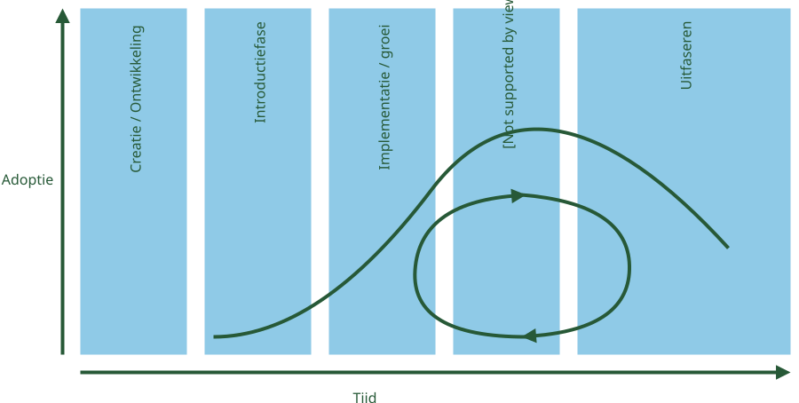
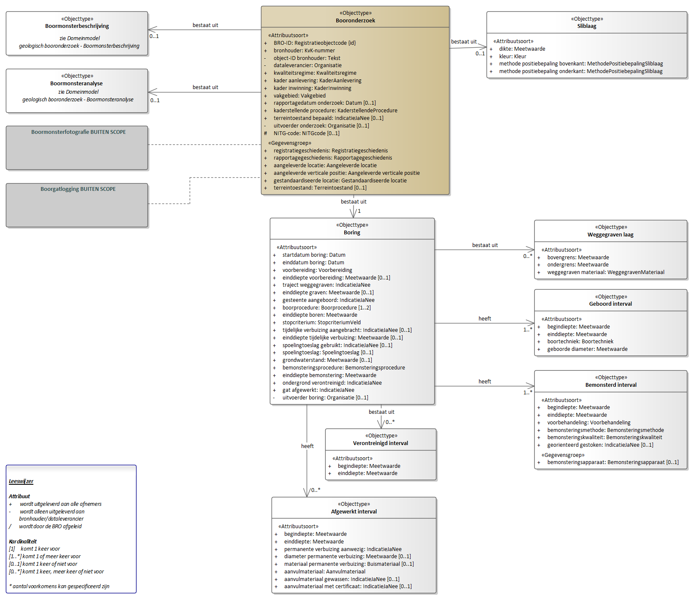
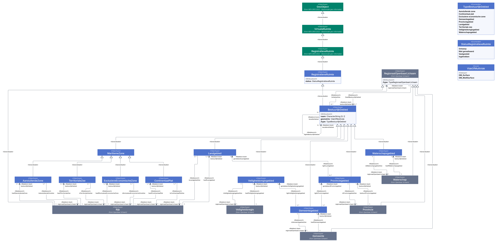

# Meer inhoud

## Definities
<dfn>Definitie</dfn>: Een definitie is een beschrijving van een woord. Een ander woord voor _definitie_ is betekenis of beschrijving.

## Afbeeldingen

### afbeelding svg md-syntax

<!-- tof uitgeschakeld Afbeeldingen krijgen een nummer en vermelding in de figurenlijst [[[#tof]]]. -->



### img svg figcaption met link in md, html-syntax

<figure id="fig-overview">
  
  <figcaption>Bomos levenscyclus, zie ook Logius <a href="https://www.logius.nl/onze-dienstverlening/infrastructuur/bomos/documentatie" target="_blank">link</a>. </figcaption>
</figure>

### magnify +magnified

#### img svg


#### img svg met figure/caption

<figure id="fig-magnify">
  
  <figcaption>Bomos levenscyclus</figcaption>
</figure>

### clickable image

#### img svg

<a href="media/Bomos_levenscyclus.svg" target="_blank" role="button" aria-label="Open window" aria-disabled="false" style="border-bottom: none;"></a>

#### img svg met figure/caption

<figure id="fig-clickable">
  <a href="media/Bomos_levenscyclus.svg" target="_blank" role="button" aria-label="Open window" aria-disabled="false" style="border-bottom: none;"></a>
  <figcaption>Bomos levenscyclus</figcaption>
</figure>

##### level5

###### level6

tekst

### imageinfo tbv panzoom

#### img svg met figure/caption

<div class="imageinfo">
<figure id="fig-panzoom">
  
  <figcaption>Bomos levenscyclus </figcaption>
</figure>
</div>

#### img png met map

 <div class="imageinfo">
 
 <map name="imagemap-EAID_B03B3DD6_C3FE_48fb_A2E3_66DF26B3775E-pz">
 <area shape="rect" alt="Boormonsteranalyse" coords="14,163,350,267" href="#graph_EAID_D7019E53_2AEA_424d_B23C_BFE117C25244"><area shape="rect" alt="Boormonsterbeschrijving" coords="14,27,350,131" href="#graph_EAID_D89A831D_A496_41a9_AE6D_57069276AAC1"><area shape="rect" alt="Sliblaag" coords="1152,27,1627,185" href="#graph_EAID_6B7C049A_F2ED_4391_AEE5_49B2A387FDDF"><area shape="rect" alt="Afgewerkt interval" coords="643,1177,1033,1405" href="#graph_EAID_6B4288D5_BEF3_4680_90F4_9F076D0FC218"><area shape="rect" alt="Verontreinigd interval" coords="770,1015,1033,1137" href="#graph_EAID_16F266E3_C973_4529_966E_A77E16CDBA8A"><area shape="rect" alt="Bemonsterd interval" coords="1265,877,1627,1111" href="#graph_EAID_0575B591_1E52_4c9b_A2D6_F043C4141D37"><area shape="rect" alt="Geboord interval" coords="1265,685,1627,843" href="#graph_EAID_ABF55F88_28B6_4d57_8D8A_F121A3AA0F51"><area shape="rect" alt="Weggegraven laag" coords="1265,521,1627,661" href="#graph_EAID_6EB72656_FB81_4560_ACB8_5C3707345FCD"><area shape="rect" alt="Boring" coords="639,516,1029,958" href="#graph_EAID_AA486803_23A2_4a00_AA43_2F9E7827E064"><area shape="rect" alt="Booronderzoek" coords="618,14,1064,461" href="#graph_EAID_660D0220_39EE_4290_AD92_C8E8CCEDB502">
 </map>
 <p><b>Domeinmodel geologisch booronderzoek - Algemeen deel</b></p>
</div>

#### img png met map en figure/caption

<div class="imageinfo">
<figure class="uml-diagram" id="fig-diagram-gpp-algemeen-pz">

<figcaption> - Diagram: GPP Algemeen</figcaption>
</figure>
<map name="imagemap-EAID_8A238AA8_87EB_46bf_B38F_4D4C086EDF94-pz"><area shape="rect" alt="GemonitordObject" coords="878,317,1001,380" href="#global_class_IMGeluid_GemonitordObject"><area shape="rect" alt="GeluidgegevenscollectieElement" coords="390,97,595,207" href="#global_class_IMGeluid_GeluidgegevenscollectieElement"><area shape="rect" alt="Geluidgegevenscollectie" coords="725,14,995,265" href="#global_class_IMGeluid_Geluidgegevenscollectie"><area shape="rect" alt="Geluidemissieobject" coords="446,393,675,535" href="#global_class_IMGeluid_Geluidemissieobject"><area shape="rect" alt="Geluidoverdrachtobject" coords="166,393,408,535" href="#global_class_IMGeluid_Geluidoverdrachtobject"><area shape="rect" alt="Bodemvlak" coords="323,721,529,841" href="#global_class_IMGeluid_Bodemvlak"><area shape="rect" alt="Geluidschermdeel" coords="14,698,298,936" href="#global_class_IMGeluid_Geluidschermdeel"><area shape="rect" alt="Hoogtelijn" coords="540,720,783,841" href="#global_class_IMGeluid_Hoogtelijn"><area shape="rect" alt="Geluidberekeningobject" coords="835,770,1151,965" href="#global_class_IMGeluid_Geluidberekeningobject"><area shape="rect" alt="Documentverwijzing" coords="1249,458,1450,628" href="#global_class_IMGeluid_Documentverwijzing"><area shape="rect" alt="Geluidaandachtsgebied" coords="1240,64,1479,215" href="#global_class_IMGeluid_Geluidaandachtsgebied"><area shape="rect" alt="Geluidproductieplafondobject" coords="835,432,1120,679" href="#global_class_IMGeluid_Geluidproductieplafondobject"></map>
<p></p>
<p>GPP Algemeen bevat objecttypen en relaties met in ieder geval betrekking tot geluidproductieplafonds, onderliggende geluidbrongegevens en juridische vaststellingen. GPP algemeen omvat drie subdomeinen: GPP Industie, GPP Wegen en GPP Spoor. Een aantal objecten zijn al eerder verschenen in het Basismodel, maar worden hier verder gespecificeerd. Zo worden binnen dit domein een aantal  Geluidoverdrachtobjecten gespecificeerd. Een voorbeeld hiervan is het Geluidschermdeel dat in alle GPP domeinen gebruikt wordt.</p>
<p></p>
<p>Klik met de rechtermuisknop op het diagram om de afbeelding op volledige grootte in een nieuw tabblad te openen</p>
<p></p>
</div>

### modeldesk

#### img svg


#### img svg met figure/caption

<figure id="fig-modeldesk">
  
  <figcaption>Bomos levenscyclus </figcaption>
</figure>

#### img png met map

 
 <map name="imagemap-EAID_B03B3DD6_C3FE_48fb_A2E3_66DF26B3775E-md">
 <area shape="rect" alt="Boormonsteranalyse" coords="14,163,350,267" href="#graph_EAID_D7019E53_2AEA_424d_B23C_BFE117C25244"><area shape="rect" alt="Boormonsterbeschrijving" coords="14,27,350,131" href="#graph_EAID_D89A831D_A496_41a9_AE6D_57069276AAC1"><area shape="rect" alt="Sliblaag" coords="1152,27,1627,185" href="#graph_EAID_6B7C049A_F2ED_4391_AEE5_49B2A387FDDF"><area shape="rect" alt="Afgewerkt interval" coords="643,1177,1033,1405" href="#graph_EAID_6B4288D5_BEF3_4680_90F4_9F076D0FC218"><area shape="rect" alt="Verontreinigd interval" coords="770,1015,1033,1137" href="#graph_EAID_16F266E3_C973_4529_966E_A77E16CDBA8A"><area shape="rect" alt="Bemonsterd interval" coords="1265,877,1627,1111" href="#graph_EAID_0575B591_1E52_4c9b_A2D6_F043C4141D37"><area shape="rect" alt="Geboord interval" coords="1265,685,1627,843" href="#graph_EAID_ABF55F88_28B6_4d57_8D8A_F121A3AA0F51"><area shape="rect" alt="Weggegraven laag" coords="1265,521,1627,661" href="#graph_EAID_6EB72656_FB81_4560_ACB8_5C3707345FCD"><area shape="rect" alt="Boring" coords="639,516,1029,958" href="#graph_EAID_AA486803_23A2_4a00_AA43_2F9E7827E064"><area shape="rect" alt="Booronderzoek" coords="618,14,1064,461" href="#graph_EAID_660D0220_39EE_4290_AD92_C8E8CCEDB502">
 </map>  
**Domeinmodel geologisch booronderzoek - Algemeen deel**

#### img png met map en figure/caption

<figure class="uml-diagram" id="fig-diagram-gpp-algemeen-md">

<figcaption> - Diagram: GPP Algemeen</figcaption>
</figure>
<map name="imagemap-EAID_8A238AA8_87EB_46bf_B38F_4D4C086EDF94-md"><area shape="rect" alt="GemonitordObject" coords="878,317,1001,380" href="#global_class_IMGeluid_GemonitordObject"><area shape="rect" alt="GeluidgegevenscollectieElement" coords="390,97,595,207" href="#global_class_IMGeluid_GeluidgegevenscollectieElement"><area shape="rect" alt="Geluidgegevenscollectie" coords="725,14,995,265" href="#global_class_IMGeluid_Geluidgegevenscollectie"><area shape="rect" alt="Geluidemissieobject" coords="446,393,675,535" href="#global_class_IMGeluid_Geluidemissieobject"><area shape="rect" alt="Geluidoverdrachtobject" coords="166,393,408,535" href="#global_class_IMGeluid_Geluidoverdrachtobject"><area shape="rect" alt="Bodemvlak" coords="323,721,529,841" href="#global_class_IMGeluid_Bodemvlak"><area shape="rect" alt="Geluidschermdeel" coords="14,698,298,936" href="#global_class_IMGeluid_Geluidschermdeel"><area shape="rect" alt="Hoogtelijn" coords="540,720,783,841" href="#global_class_IMGeluid_Hoogtelijn"><area shape="rect" alt="Geluidberekeningobject" coords="835,770,1151,965" href="#global_class_IMGeluid_Geluidberekeningobject"><area shape="rect" alt="Documentverwijzing" coords="1249,458,1450,628" href="#global_class_IMGeluid_Documentverwijzing"><area shape="rect" alt="Geluidaandachtsgebied" coords="1240,64,1479,215" href="#global_class_IMGeluid_Geluidaandachtsgebied"><area shape="rect" alt="Geluidproductieplafondobject" coords="835,432,1120,679" href="#global_class_IMGeluid_Geluidproductieplafondobject"></map>

GPP Algemeen bevat objecttypen en relaties met in ieder geval betrekking tot geluidproductieplafonds, onderliggende geluidbrongegevens en juridische vaststellingen. GPP algemeen omvat drie subdomeinen: GPP Industie, GPP Wegen en GPP Spoor. Een aantal objecten zijn al eerder verschenen in het Basismodel, maar worden hier verder gespecificeerd. Zo worden binnen dit domein een aantal  Geluidoverdrachtobjecten gespecificeerd. Een voorbeeld hiervan is het Geluidschermdeel dat in alle GPP domeinen gebruikt wordt.

#### CIM BG {#informatiemodel_cim_bg}

##### Domein BG {#informatiemodel_cim_bg_domein_bestuurlijk_gebied}

<figure data-md-diagram="d3377e86-4b10-35f5-a084-d597da5e2c2b">
<div data-include="data/package-view.svg" data-include-format="html"></div>
<figcaption>Domein Bestuurlijk gebied</figcaption>
</figure>


## Referenties

Referenties kunnen op drie plaatsen staan:

- In SpecRef [Specref](https://www.specref.org/)
- In de organisatie configuraties [[SemVer]]. Deze zijn te vinden op [tools.geostandaarden.nl](https://github.com/Geonovum/tools.geostandaarden.nl/blob/main/tools.geostandaarden.nl/respec/config/geonovum-config.mjs).
- In het document, zoals [[MIM12]]. Deze zijn te vinden in `js/config.mjs`.

Referentie uit organisatie lijst [[SemVer]] of de locale lijst [[MIM12]]. Alleen referenties die in de tekst voorkomen worden getoond.

We gebruiken een <a>definitie</a> om een woord te omschrijven.

## Optioneel

De onderstaande secties (_Conformiteit_ e.d.) zijn optioneel, zie `index.html`:

```
<body>
  <section id="abstract" data-include-format="markdown" data-include="abstract.md"></section>
  <section id="sotd"></section><!-- Wordt automatisch gevuld -->
  <section data-include-format="markdown" class="informative" data-include="ch01.md"></section>
  <section data-include-format="markdown" data-include="ch02.md"></section>
  <!-- Hieronder optionele secties. Worden automatisch gevuld -->
  <section id='conformance'></section>
  <section id='tof'></section>
  <section id="index"></section>
</body>
```
